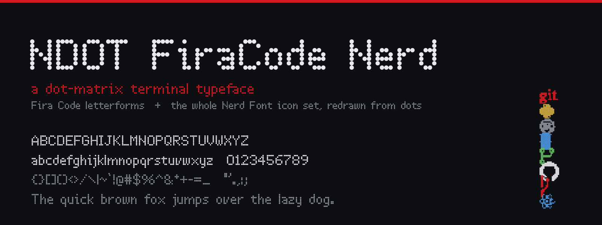
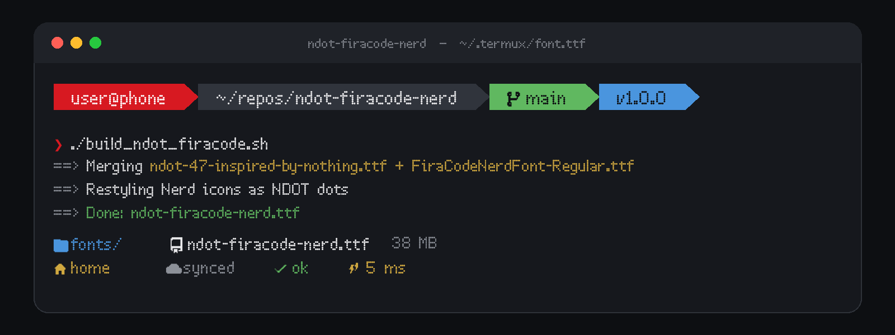
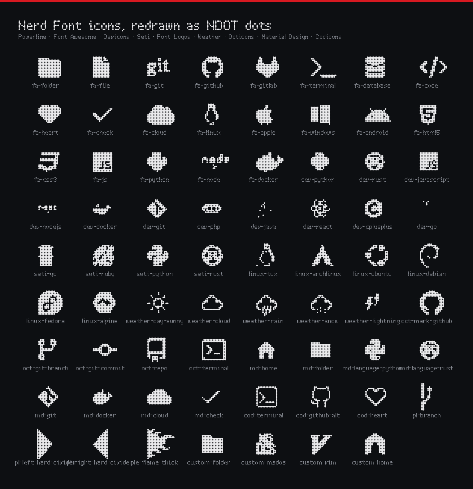

# NDOT FiraCode Nerd

A personal terminal font that renders [Nerd Font](https://github.com/ryanoasis/nerd-fonts)
icons in the dot-matrix style of **Nothing's NDOT** while keeping normal
letterforms untouched.



The build merges two fonts and then redraws only the icon plane:

| Role | Font | Code points |
| --- | --- | --- |
| Base (wins on overlap) | `ndot-47-inspired-by-nothing.ttf` — NDOT-style dot-matrix | letters, digits, punctuation |
| Merge (fills the gaps) | `FiraCodeNerdFont-Regular.ttf` — Fira Code + Nerd Font patches | everything the base lacks |
| Restyled | Nerd Font icons (PUA `E000–F8FF`, `F0000–FFFFD`, `100000–10FFFD`) | redrawn as NDOT-style dots |

Result: a ~38 MB TrueType face with ~12,885 glyphs, GSUB/GPOS intact,
installed/usable in Termux.

```
ndot-firacode-nerd.ttf   # NDOT 47 base (2048 upm)  — published as a Release
ndot57-firacode-nerd.ttf # Ndot57 base (1000 upm)  — personal build only, not distributed
```

The two source fonts are bundled in the repo (both freely licensed — see
Compliance). Built outputs are published as [Releases](#releases) rather than
committed.

## Preview



Every Nerd Font icon is redrawn from dots — Powerline, Font Awesome, Devicons,
Seti, Font Logos, Weather, Octicons, Material Design and Codicons:



Images are generated from the built font by `docs/make_preview.py`.

## Source fonts

Bundled at the repo root:

| File | Origin | License |
| --- | --- | --- |
| `ndot-47-inspired-by-nothing.ttf` | [FontStruct → "NDOT 47 (inspired by NOTHING)"](https://fontstruct.com/fontstructions/show/2047444/ndot-45-inspired-by-nothing-1) by Interactivate | SIL OFL 1.1 |
| `FiraCodeNerdFont-Regular.ttf` | [nerd-fonts](https://github.com/ryanoasis/nerd-fonts/releases) → `FiraCode.zip` | SIL OFL 1.1 + MIT |

## Build

Requires FontForge (CLI), Python 3, `fonttools`, `numpy`.

```bash
./build_ndot_firacode.sh                          # NDOT 47 → ndot-firacode-nerd.ttf
./build_ndot_firacode.sh --cells 20               # any extra args pass to the restyle step
```

Environment overrides: `BASE`, `MERGE`, `OUT`, `FAMILY`, `PSNAME`.
What it does:

1. `native_merge.pe` (FontForge) merges base + merge, scaling the merge font
   onto the base's units-per-em so the base wins cleanly on shared glyphs.
   Output format follows the extension: `.ttf` → TrueType, `.otf` → CFF.
2. `ndot_nerd_symbols.py` (fontTools + numpy) rasterizes each icon's outline
   on a dot grid (default 16 cells/em, touching circles, 3×3 sub-sampling,
   0.34 coverage threshold) and rebuilds the glyph from dots. Handles both
   `glyf` (TTF) and CFF (OTF) tables, recalculating bounds and side bearings.

Install on Termux:

```bash
cp ndot-firacode-nerd.ttf ~/.termux/fonts/
cp ndot-firacode-nerd.ttf ~/.termux/font.ttf && termux-reload-settings
```

## Releases

The prebuilt face is attached to
[Releases](https://github.com/GeneralKaos666/ndot-firacode-nerd/releases):

| Asset | Base | License |
| --- | --- | --- |
| `ndot-firacode-nerd.ttf` | NDOT 47 (OFL) | SIL OFL 1.1 — free to use, modify and share |

A second face built from Nothing's proprietary Ndot57 base exists (see
Compliance) but is **not published here**.

## Inspired by / credits

All design credit for the underlying work goes to its upstream authors —
this repo only merges and restyles their fonts:

- **[Nothing Technology Ltd.](https://nothing.tech/)** — the NDOT / NType
  dot-matrix design language this project is inspired by, crafted by
  **Seventy Agency** alongside **Colophon Foundry**. "NOTHING", "Ndot" and
  "NType" are trademarks of Nothing Technology Ltd. This project is
  unofficial, unaffiliated, and not endorsed by Nothing.
- **[Interactivate — "NDOT 45 (inspired by NOTHING)"](https://fontstruct.com/fontstructions/show/1947061/ndot-45-inspired-by-nothing)** /
  **[NDOT 47](https://fontstruct.com/fontstructions/show/2047444/ndot-45-inspired-by-nothing-1)**
  — the open OFL dot-matrix base (`ndot-47-inspired-by-nothing.ttf`), ©
  Interactivate 2021, a FontStruct font. Licensed under the
  [SIL Open Font License 1.1](OFL-1.1.txt).
- **[The Fira Code project](https://github.com/tonsky/FiraCode)** — the
  letterforms, © 2014–2021 The Fira Code Project Authors. Licensed under the
  [SIL Open Font License 1.1](OFL-1.1.txt).
- **[ryanoasis/nerd-fonts](https://github.com/ryanoasis/nerd-fonts)** — the
  icon font (Font Awesome, Material Design Icons, Devicons, Powerline, etc.)
  and `Font Patcher` ecosystem, by Ryan L McIntyre and contributors.
  Code under MIT, patched fonts under OFL 1.1 (see their
  [license](https://github.com/ryanoasis/nerd-fonts/blob/master/LICENSE)).
- **[xeji01 "nothingfont"](https://github.com/xeji01/nothingfont)** — local
  source of the Ndot57 variant used for experimentation. Proprietary — see
  Compliance.

## Compliance

This repository distributes **only** code, docs, and openly licensed source
fonts:

| Component | License | In this repo? |
| --- | --- | --- |
| Our build scripts (`native_merge.pe`, `ndot_nerd_symbols.py`, `build_ndot_firacode.sh`, README) | MIT | ✅ `LICENSE` |
| `ndot-47-inspired-by-nothing.ttf` (base) | SIL OFL 1.1 | ✅ bundled |
| `FiraCodeNerdFont-Regular.ttf` (merge) | SIL OFL 1.1 + MIT (Nerd Fonts patches) | ✅ bundled |
| `Ndot57-Regular.otf` and the other Nothing/Lineto fonts | **proprietary** | ❌ kept local in `~/downloads` |

Nothing's NDOT font EULA states the font may be used *solely on Nothing brand
materials* and must **not** be modified, shared, or redistributed. Because a
build modifies the base, the **Ndot57 variant is for personal/local use only**
and is deliberately not shipped here or in any release. The
`build_ndot_firacode.sh` example for Ndot57 points at a local copy you supply
yourself; do not redistribute builds produced from the proprietary bases.

The generated merged fonts themselves build on OFL-licensed work
(Fira Code + NDOT47), so **`ndot-firacode-nerd.ttf` may be used, modified and
redistributed freely** under the SIL OFL 1.1, provided the upstream
attributions above are preserved.