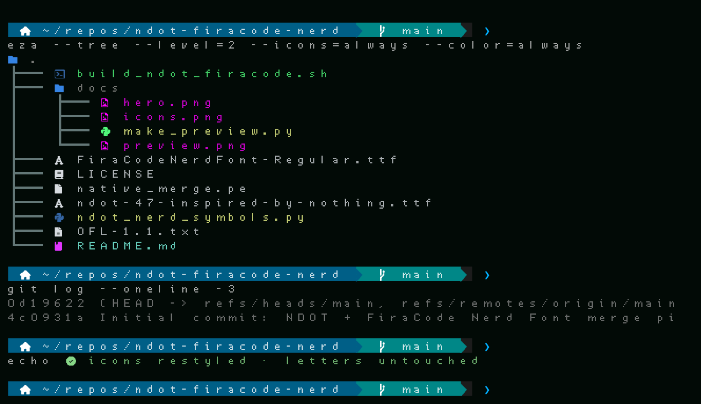
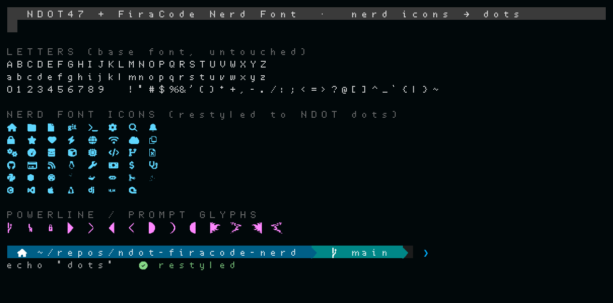

# NDOT FiraCode Nerd

A terminal font that combines a **dot-matrix (NDOT-style) base** with
**FiraCode Nerd Font**, then redraws the Nerd Font icons as dots to match.
Letters, digits and punctuation keep the base font's shapes — only the icon
plane is restyled.


## How it works

The build merges two fonts and then restyles the icons:

| Role | Font | Covers |
| --- | --- | --- |
| **Base** — wins where both fonts have the same glyph | `ndot-47-inspired-by-nothing.ttf` (NDOT-style dot matrix) | letters, digits, punctuation |
| **Merge** — fills in whatever the base is missing | `FiraCodeNerdFont-Regular.ttf` (Fira Code + Nerd Font patches) | everything else |
| **Restyled** | Nerd Font icons in the Private Use Areas (`U+E000–U+F8FF`, `U+F0000–U+FFFFD`, `U+100000–U+10FFFD`) | redrawn as NDOT-style dots |

The result is a single TrueType file of about 38 MB and roughly 12,885 glyphs,
with the original GSUB/GPOS layout tables kept intact.

Two faces can be built:

| File | Base | Distributed? |
| --- | --- | --- |
| `ndot-firacode-nerd.ttf` | NDOT 47 (open, 2048 upm) | **Yes** — attached to a [Release](#releases) |
| `ndot57-firacode-nerd.ttf` | Ndot57 (proprietary, 1000 upm) | **No** — personal build only, kept local |

## Preview

Real screenshots taken in a terminal on Android (Termux) with the built font
installed:



Every Nerd Font icon is drawn from dots — Powerline, Font Awesome, Devicons,
Seti, Font Logos, Weather, Octicons, Material Design and Codicons — while
letters, digits and punctuation keep the base font's dot-matrix forms:



Font specimens rendered straight from the built font can be regenerated with
`docs/make_preview.py`.

## Source fonts

Both source fonts are bundled in this repository at the repo root, and both are
openly licensed:

| File | Origin | License |
| --- | --- | --- |
| `ndot-47-inspired-by-nothing.ttf` | [FontStruct — "NDOT 47 (inspired by NOTHING)"](https://fontstruct.com/fontstructions/show/2047444/ndot-45-inspired-by-nothing-1) by Interactivate | SIL OFL 1.1 |
| `FiraCodeNerdFont-Regular.ttf` | [Fira Code](https://github.com/tonsky/FiraCode) patched by [Nerd Fonts](https://github.com/ryanoasis/nerd-fonts/releases) (from `FiraCode.zip`) | SIL OFL 1.1 (Fira Code) + MIT (Nerd Fonts) |

## Build

You need FontForge, Python 3, `fonttools` and `numpy`.

```bash
./build_ndot_firacode.sh              # builds ndot-firacode-nerd.ttf
./build_ndot_firacode.sh --cells 20   # extra arguments go to the restyle step
```

The build runs in three steps:

1. **`native_merge.pe`** (FontForge) merges the base with the merge font,
   scaling the merge font onto the base's units-per-em. Because the base comes
   first, it wins wherever the two fonts share a glyph. The output format
   follows the file extension: `.ttf` gives TrueType outlines, `.otf` gives CFF.
2. **`ndot_nerd_symbols.py`** (fontTools + numpy) rasterises each icon's
   outline onto a dot grid — 16 cells per em by default, touching circles, 3×3
   sub-sampling and a 0.34 coverage threshold — and rebuilds the glyph from
   dots. It handles both `glyf` (TTF) and CFF (OTF) tables, and recalculates
   the glyph bounds and side bearings.
3. **Licence embedding** — the script writes the upstream copyright notice, the
   full OFL 1.1 text and the license URL into the font's `name` table. It is a
   byte-level edit (the new table is appended and the sfnt checksums are
   recomputed), so the font ends up carrying its own licence.

`BASE`, `MERGE`, `OUT`, `FAMILY` and `PSNAME` override the inputs and naming.
`LICENSE_FILE` (default `OFL-1.1.txt`) is the notice text; set it empty to skip
embedding, which is required for proprietary-base builds. `LICENSE_COPYRIGHT`,
`LICENSE_TRADEMARK` and `LICENSE_URL` override the notice text. See the top of
`build_ndot_firacode.sh` for the details.

### Install on Termux

```bash
cp ndot-firacode-nerd.ttf ~/.termux/fonts/
cp ndot-firacode-nerd.ttf ~/.termux/font.ttf && termux-reload-settings
```

## Releases

The prebuilt face is attached to
[Releases](https://github.com/GeneralKaos666/ndot-firacode-nerd/releases):

| Asset | Base | License |
| --- | --- | --- |
| `ndot-firacode-nerd.ttf` | NDOT 47 (open) | SIL OFL 1.1 — free to use, modify and share |

The Ndot57 face is deliberately **not** published here (see below).

## Credits

The original designs belong to their authors; this project only merges and
restyles their fonts.

- **[Nothing Technology Ltd.](https://nothing.tech/)** — the NDOT / NType
  dot-matrix design language that inspired this project, made with
  **Seventy Agency** and **Colophon Foundry**. "NOTHING", "Ndot" and "NType"
  are trademarks of Nothing Technology Ltd. This project is unofficial,
  unaffiliated and not endorsed by Nothing.
- **[Interactivate](https://fontstruct.com/fontstructors/show/1939594/interactivate)**
  — the FontStruct designer of
  [NDOT 45](https://fontstruct.com/fontstructions/show/1947061/ndot-45-inspired-by-nothing)
  and [NDOT 47](https://fontstruct.com/fontstructions/show/2047444/ndot-45-inspired-by-nothing-1)
  "(inspired by NOTHING)". NDOT 47 is the open OFL dot-matrix base used here,
  © Interactivate 2021, licensed under the
  [SIL Open Font License 1.1](OFL-1.1.txt).
- **[The Fira Code project](https://github.com/tonsky/FiraCode)** — the
  letterforms, © 2014–2021 The Fira Code Project Authors, licensed under the
  [SIL Open Font License 1.1](OFL-1.1.txt).
- **[ryanoasis/nerd-fonts](https://github.com/ryanoasis/nerd-fonts)** — the
  icon glyphs (Font Awesome, Material Design Icons, Devicons, Powerline, and
  the rest) and the `Font Patcher` tooling, by Ryan L McIntyre and
  contributors. Code under MIT, patched fonts under OFL 1.1.
- **[xeji01/nothingfont](https://github.com/xeji01/nothingfont)** — local
  origin of the Ndot57 base used for experimentation. Proprietary; not
  distributed here.

Full copyright and license details for every upstream component are in
[`THIRD-PARTY-NOTICES.md`](THIRD-PARTY-NOTICES.md).

## Licensing and compliance

This repository ships **only** code, docs and openly licensed source fonts:

| Component | License | In this repo? |
| --- | --- | --- |
| Our build scripts, docs and README | MIT | Yes — see [`LICENSE`](LICENSE) |
| `ndot-47-inspired-by-nothing.ttf` (base) | SIL OFL 1.1 | Yes — bundled |
| `FiraCodeNerdFont-Regular.ttf` (merge) | SIL OFL 1.1 + MIT | Yes — bundled |
| Nothing's Ndot57 and the other Nothing/Lineto fonts | **Proprietary** | No — kept local, never uploaded |

### Why the Ndot57 face is not published

Nothing's font EULA permits the font on Nothing brand materials only, and
forbids modifying, sharing or redistributing it. Because building this font
*does* modify the base, the **Ndot57 variant is for personal, local use only**
and is deliberately left out of this repository and every release. Build it
yourself from a copy you own — the example in `build_ndot_firacode.sh` shows
how — and do not redistribute the result.

### What the built font is licensed under

`ndot-firacode-nerd.ttf` is built entirely from OFL-licensed work (Fira Code
and NDOT 47), so it may be used, modified and redistributed under the
**SIL Open Font License 1.1**, provided the upstream notices above and in
[`THIRD-PARTY-NOTICES.md`](THIRD-PARTY-NOTICES.md) are kept with it.

The released font also carries these terms inside the file itself: its `name`
table embeds the upstream copyright notice, the full OFL 1.1 text and the
license URL, so the license travels with the `.ttf` even on its own.
